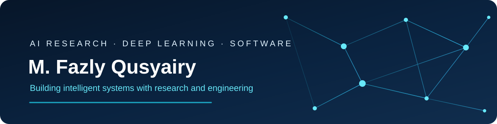

  

<h1 align="center">M. Fazly Qusyairy</h1>

  <strong>AI Research · Deep Learning · Medical Image Analysis · Software Engineering</strong>

  
  
  

---

## Profile

I am a computer science professional with a background in **Informatics Engineering (B.Sc.)** and a **Master of Computer Science** from **Universitas Esa Unggul**. My interests sit at the intersection of applied artificial intelligence, deep learning research, and practical software development.

I enjoy translating technical ideas into documented, testable prototypes—from 3D medical-image analysis to AI-assisted cybersecurity review and information systems for higher education.

**My working principles:** reproducible experiments, evidence-based evaluation, responsible AI, and software that is understandable and maintainable.

## Areas of focus

| Domain | Focus |
|---|---|
| **Medical AI & Computer Vision** | 3D CT image segmentation, NIfTI data, medical-image visualization |
| **Deep Learning Research** | CBAM attention, U²-Net / RSU blocks, hierarchical anatomical masking |
| **Applied AI & Cybersecurity** | NIST CSF 2.0, semantic retrieval, AI-assisted policy-gap review |
| **Software & Information Systems** | Python applications, research workbenches, higher-education quality processes |

## Selected projects

### 01 · 3D Colorectal Tumor Segmentation
**Research prototype · Medical AI · Deep Learning**

A research codebase exploring binary **CBAM-RSU2Net** segmentation with a separate external colon anatomical prior for 3D colorectal CT volumes.

- Implements a binary tumor/background model direction based on an audit of the supplied label masks.
- Documents sample-level anatomical-prior quality checks and tumor-coverage analysis.
- Includes research protocols, scripts, configuration, and unit tests.

**Research status:** the documented prior-quality pilot covers three selected cases. Full-cohort prior evaluation and end-to-end model training/validation are not yet claimed as completed.

**Stack:** Python · PyTorch · MONAI · NiBabel · NIfTI

➡️ [View the research repository](https://github.com/mfazlyq/colorectal-3d-segmentation)

### 02 · Medical AI Research Workbench
**Research software · 3D Medical Imaging · Data Visualization**

A local-first application for inspecting 3D NIfTI CT volumes, reviewing Ground Truth / Colon Prior / AI Prediction overlays, checking spatial geometry, and calculating binary segmentation metrics.

- Axial, coronal, and sagittal visualization.
- Overlay review and NIfTI geometry checks.
- Dice, IoU, precision, recall, accuracy, and prior-coverage calculations.
- Synthetic demo data for local exploration.

**Current scope:** a viewer and evaluation workbench; model training and CBAM-RSU2Net inference are outside the current release.

**Stack:** Python · Streamlit · NiBabel · NumPy · Plotly

➡️ [View the application repository](https://github.com/mfazlyq/medical-ai-research-workbench)

### 03 · NIST AI Audit Assistant
**Applied AI · Cybersecurity Governance · Decision Support**

A Streamlit research prototype for exploring AI-assisted review of institutional cybersecurity policies and procedures against the **NIST Cybersecurity Framework (CSF)**.

- PDF extraction, semantic chunking, embedding, and retrieval.
- LLM-assisted drafting of potential gap findings.
- Structured findings, visual summaries, and report exports.
- Unit tests and GitHub Actions workflow.

**Responsible-use note:** generated findings are preliminary decision support. Evidence, control mapping, and recommendations require review by a qualified human auditor; this is not a compliance certification tool.

**Stack:** Python · Streamlit · LangChain · Chroma · Hugging Face Embeddings · Groq

➡️ [View the project repository](https://github.com/mfazlyq/audit-nist-ai)

## Technical toolbox

  
  
  
  
  
  
  
  
  
  
  

## Academic background

**Universitas Esa Unggul**
- Master of Computer Science
- Bachelor of Informatics Engineering

**Research interests:** medical image analysis, deep learning, computer vision, responsible AI, cybersecurity governance, and information systems in higher education.

## Portfolio website

A responsive academic and research portfolio presenting my focus in artificial intelligence, deep learning research, biomedical image analysis, education technology, and selected projects.

➡️ [Explore the portfolio website](portfolio-site/README.md)

## Connect & explore

- [GitHub profile](https://github.com/mfazlyq)
- [All public repositories](https://github.com/mfazlyq?tab=repositories)

---

  Research with evidence. Engineering with purpose. AI applied responsibly.

